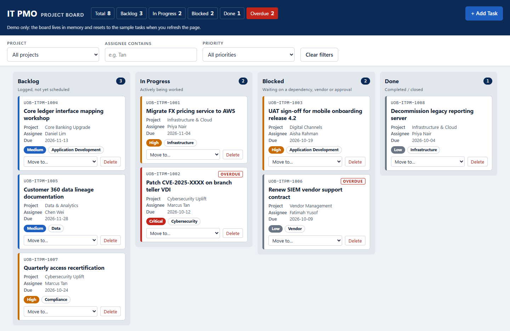

# kanban6: IT PMO Project Board

A Kanban board for tracking UOB IT PMO tasks across Backlog, In Progress, Blocked and Done. It is a single `index.html` file in vanilla HTML, CSS and JavaScript, with no dependencies and no external resources.

**Live site:** https://niralimehta700-oss.github.io/kanban6/

## Features

- Four columns with drag and drop, plus a keyboard-friendly "Move to…" control on every card
- Priority-coloured card borders (Critical, High, Medium, Low) and an Overdue badge
- Add Task form with inline validation; IDs follow `UOB-ITPM-####`
- New tasks are emailed through FormSubmit (see below)
- Filter by project, assignee and priority; a live summary strip shows the counts
- Inline delete confirmation
- 8 sample tasks; nothing is stored, so a refresh resets the board
- Accessible markup, visible focus, light and dark themes

## Run locally

Open `index.html` in any modern browser.

## FormSubmit setup

Set `FORMSUBMIT_ENDPOINT` in `index.html` to `https://formsubmit.co/ajax/<your email>`. The first task you add sends FormSubmit's activation email; click **Activate Form** in it, and later submissions are delivered.

## Screenshot

